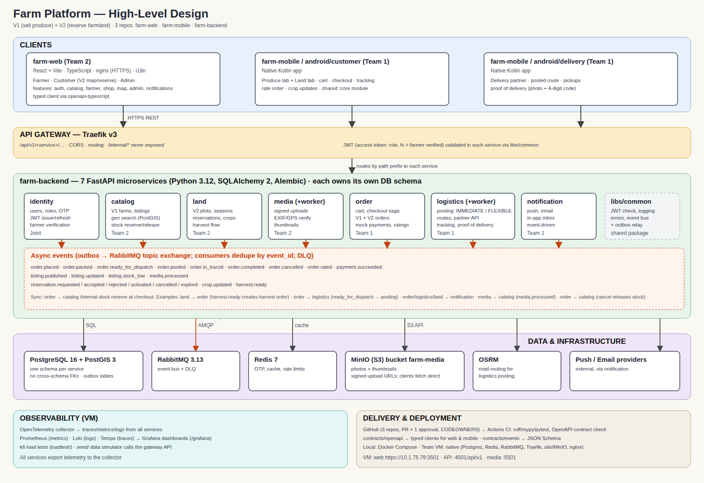

# farm-backend

Shared microservice backend for the Farm Platform: **V1** (selling farm produce) and **V2** (farmland reservation).
Both teams commit here; the website ([farm-web](https://github.com/lakshayg2005/farm-web)) and the apps ([farm-mobile](https://github.com/lakshayg2005/farm-mobile)) consume its APIs.

## Architecture



## Links

| What | URL |
| --- | --- |
| Website, team VM | <http://10.1.75.79:3501> |
| API gateway, team VM | <http://10.1.75.79:4501/api/v1> (e.g. `/identity/login`, `/catalog/listings/search`) |
| Swagger UI of one service, team VM | `http://10.1.75.79:4501/api/v1/<service>/docs` |
| Photo storage, team VM | <http://10.1.75.79:5501> |
| Website, local | <http://localhost:5173> (`pnpm dev` in farm-web) |
| API gateway, local | <http://localhost/api/v1> (`docker compose up -d`) |
| Swagger UI, local | `http://localhost/api/v1/<service>/docs` |
| RabbitMQ / MinIO console, local | <http://localhost:15672> / <http://localhost:9001> |
| Backend repo | <https://github.com/lakshayg2005/farm-backend> |
| Website repo | <https://github.com/lakshayg2005/farm-web> |
| Apps repo (Kotlin in `android/`) | <https://github.com/lakshayg2005/farm-mobile> |

The team VM is only reachable from the college network or VPN. Demo logins for every role: [docs/DEMO.md](docs/DEMO.md).
Demo walkthrough: [docs/DEMO-SCRIPT.md](docs/DEMO-SCRIPT.md). Plan and status: [docs/ROADMAP.md](docs/ROADMAP.md).
Android work: [docs/android-handoff.md](docs/android-handoff.md), and the prompt to start it: [docs/android-prompt.md](docs/android-prompt.md).

## Stack

Python 3.12 + FastAPI per service, SQLAlchemy 2 + GeoAlchemy2 + Alembic, PostgreSQL 16 + PostGIS 3 (one schema per service),
RabbitMQ for events, Redis, MinIO (S3) for photos, Traefik as the API gateway, uv for packages, Docker Compose to run everything.

## Services

| Service | Owner | Responsibility |
| --- | --- | --- |
| `identity` | Joint | Users, roles, phone OTP, JWT issue and refresh, farmer verification |
| `catalog` | Team 2 | V1 farms and produce listings, geo search, stock reserve/release |
| `land` | Team 2 | V2 plots, seasons, reservations, crop updates, harvest flow |
| `media` | Team 2 | Signed photo uploads, EXIF/GPS verification, thumbnails |
| `order` | Team 1 | Cart, checkout saga, V1 and V2 orders, mock payments |
| `logistics` | Team 1 | Delivery pooling, routes, partner app API, tracking, proof of delivery |
| `notification` | Team 1 | Push, email and in-app inbox, driven by events |

The gateway (Traefik) routes `/api/v1/<service>/...` to each service. Routes under `/internal/...` are never exposed.

## Layout

```text
services/<service>/      one FastAPI app each: own pyproject.toml, Dockerfile, schema and migrations
contracts/openapi/       OpenAPI spec per service, exported from FastAPI by CI
contracts/events/        JSON Schema per event (e.g. order.placed)
libs/common/             shared Python package: JWT check, logging, errors, event bus + outbox
seed/                    dummy data simulator (calls the gateway API)
infra/                   Traefik and other infrastructure config
docs/                    architecture notes and decisions
```

## Rules between services

- A service reads and writes **only its own schema**. Other services keep IDs, never cross-schema foreign keys.
- Every state change publishes an event through the **outbox** table; consumers dedupe by `event_id`.
- Synchronous calls between services only through `/internal/...` routes, and only when the answer is needed immediately (e.g. stock reserve at checkout).
- **Contracts first:** before building an endpoint, open a PR with the Pydantic models and a stub route. A member of the other team approves the contract diff.

## Workflow (all repos)

- `main` is protected: changes go in only through a pull request with 1 approval.
- One issue per branch: `feat/<area>-<short-name>` or `fix/<area>-<short-name>`. Merge within 2 to 3 days.
- Commit messages follow Conventional Commits: `feat:`, `fix:`, `chore:`, `docs:`, `test:`.
- Squash-merge PRs and write `Closes #<issue>` in the PR description.
- Never commit `.env`; copy `.env.example` instead.
- Issues are labelled by team (`team-app` = Team 1, `team-web` = Team 2, `team-joint`) and by member slot (`M1`–`M4` Team 1, `M5`–`M8` Team 2). Pick your slot and assign yourself.

## Getting started

The backend is a [uv workspace](https://docs.astral.sh/uv/concepts/projects/workspaces/): `libs/common` and every
service are separate packages that share one lockfile (`uv.lock`) and, for local development, one `.venv`.

```bash
# 1. Install uv: https://docs.astral.sh/uv/getting-started/installation/
# 2. Install Python 3.12 + all packages (run from the repo root)
uv sync --all-packages

# 3. Run one service with auto-reload
uv run --package farm-catalog uvicorn catalog_service.main:app --reload --port 8002
#    then open http://localhost:8002/docs

# 4. Checks (the same ones CI runs)
uv run pytest
uv run ruff check . && uv run ruff format --check .
uv run mypy libs/common/src services/*/src
```

| Service | Package | Local port |
| --- | --- | --- |
| identity | `identity_service` | 8001 |
| catalog | `catalog_service` | 8002 |
| land | `land_service` | 8003 |
| media | `media_service` | 8004 |
| order | `order_service` | 8006 |
| logistics | `logistics_service` | 8007 |
| notification | `notification_service` | 8008 |

**Adding a dependency to one service:** `uv add --package farm-catalog <library>` (never `pip install`).

Each service has the same layout:

```text
services/<name>/
  pyproject.toml           package farm-<name>, depends on farm-common
  Dockerfile               build from the repo root: docker build -f services/<name>/Dockerfile .
  alembic.ini, migrations/ migrations run inside the <name> schema only
  src/<name>_service/      main.py (FastAPI app), db.py (SQLAlchemy Base bound to the schema)
  tests/
```

Run everything together with Docker Compose (Postgres + PostGIS, RabbitMQ, Redis, MinIO, Traefik): see [infra/README.md](infra/README.md).
