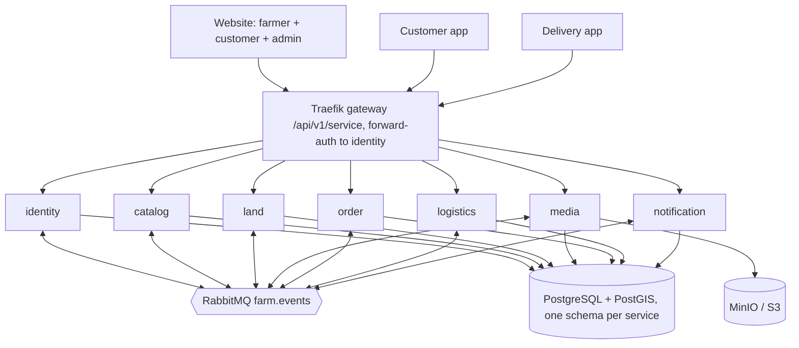
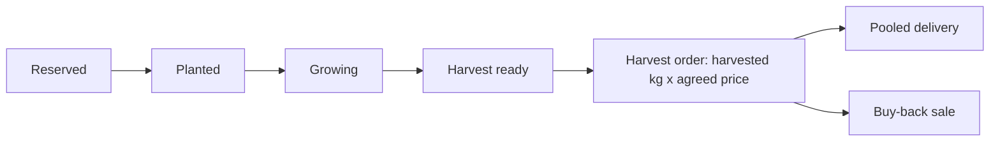

# Farm Platform (V1 + V2) — HLD and Team Plan

> This file is the official copy of the design. Change it through pull requests.

Lakshay Gupta (Team 2 lead)

> **Decision log (changes made after this design was first agreed)**
>
> - **2026-11-23: no quality gate.** Inspections, the inspector role, listing grades and the quality
>   service were removed. Packing makes a produce order READY\_FOR\_DISPATCH; marking a harvest ready
>   (with the harvested weight) creates the harvest order at once. Quality is judged by the customer:
>   proof of delivery (photo and a 4-digit code only the customer sees) and a 1 to 5 rating after
>   delivery, shown as the farm's average on its listings. The platform now runs seven services.
> - **2026-11-23: only admin-verified farmers sell.** The access token carries `fv` (farmer verified);
>   catalog and land refuse farms, listings and plots from unverified farmers (403 FARMER\_NOT\_VERIFIED).
> - **2026-11-23: seasons of one plot never overlap** (database exclusion constraint), so one piece of
>   land cannot be let twice for the same days. Ended seasons are not offered.
> - **2026-11-24: delivery modes.** At checkout the customer chooses **IMMEDIATE** (routed as soon as
>   the farmer packs it) or **FLEXIBLE** ("I can wait": a lower delivery fee, and the order is held for
>   the daily shared-delivery batch at 10:00 India time, where logistics clusters every waiting order
>   that is near each other so one partner serves a neighbourhood). See section 14.
> - **Inspectors and admins (section 2):** the website has no inspector role; admins verify farmers,
>   resolve orders and run pooling.

## 1. Overview

The platform covers V1 (selling farm produce) and V2 (reserving farmland) on one shared microservice backend. Two teams of four build it: Team 1 builds the mobile apps, Team 2 builds the website, and both teams build backend services.

- **V1:** farmers list produce on the website, customers buy it in the customer app, and delivery partners deliver pooled orders through the delivery app.
- **V2:** farmers list plots on the website; customers reserve a plot (on the website or in the customer app), pick a crop, and later get the harvest delivered or bought back.
- **Shared by both:** users, photos, orders, ratings and delivery pooling are built once and used by V1 and V2.

**Out of scope:** V3 demand forecasting. Order and delivery data is kept so V3 analytics can be added later.

## 2. Who builds what

Recommendation: build **three clients, not five**. Merge the V1 customer app and the V2 customer app into one customer app with two tabs (Produce and Land), and serve farmers and customers from one website with role-based sections. Customers then install one app, login and cart are written once, and Team 1 has two apps to maintain instead of three.

| Client | Built by | Users | V1 features | V2 features |
| --- | --- | --- | --- | --- |
| Website (React + Vite) | Team 2 | Farmers, customers, admin | Farmer: list produce with photos, manage stock, accept and pack orders, see ratings | Farmer: list plots, accept reservations, post crop updates. Customer: map search, reserve a plot, track the crop, choose delivery or buy-back |
| Customer app (Expo) | Team 1 | Customers | Browse produce near me, cart, checkout, track delivery, rate | Search plots on a map, reserve, follow crop updates, receive the harvest |
| Delivery app (Expo) | Team 1 | Delivery partners | Today's pooled route, pickup, proof of delivery (photo + OTP) | The same screens deliver harvest orders |
| Team page | Both | Everyone | Team details and a thank-you to Dr Gagan Sir with his photo, on web and in both apps | Same |

**Backend work is split by domain**, so each team owns the services its clients use most (section 9). Shared foundations (gateway, identity, Docker Compose, CI) are built jointly in the first sprint by one member from each team.

The brief doesn't say where admins work. This plan puts them on the website, because verification queues and the pooling map are easier on a large screen. (Quality inspectors were part of the first plan; the quality gate was later removed, see the decision log.)

## 3. Repository setup and Git workflow

Recommendation: **one GitHub organization with three repos**: a backend monorepo that both teams commit to, a web repo that Team 2 owns, and a mobile repo that Team 1 owns. Each team fully owns its client repo, and the shared backend repo is where the API contracts between teams live.

| Repo | Owner | Holds |
| --- | --- | --- |
| farm-backend | Both teams (each service has an owning team via CODEOWNERS) | All microservices, the API gateway, OpenAPI contracts, event schemas, shared libs, Docker Compose, seed scripts |
| farm-web | Team 2 | React + Vite website (farmer, customer and admin sections) |
| farm-mobile | Team 1 | Expo monorepo with apps/customer, apps/delivery and shared packages (UI, API client) |
| farm-docs (optional) | Both | HLD, decision records, meeting notes, final report; the GitHub wiki works too |

**Why not one repo per microservice?** Nine service repos for eight people means nine CI pipelines, a shared library copied or versioned nine times, and one feature touching several repos and PRs. **Why not one repo for everything?** The backend is Python and the clients are JavaScript, so one repo would mix two toolchains (uv and pnpm), and every backend push would trigger both client teams' CI.

**It is still microservices.** Inside farm-backend, each service has its own folder, pyproject.toml, Dockerfile, database schema and container. Services never import each other's code; they share only libs/common and talk over HTTP or events.

```text
farm-backend/
  services/
    gateway/  identity/  catalog/  land/  order/
    logistics/  media/  notification/
  contracts/
    openapi/<service>.json     # exported from FastAPI by CI
    events/<event>.json        # JSON Schema per event
  libs/common/                 # Python package: JWT check, logger, event client, errors
  seed/                        # dummy data simulator
  docker-compose.yml
  .github/CODEOWNERS  .github/workflows/
```

**Contracts first, so no team waits on the other**

1. Before building an endpoint, its owner opens a PR with the Pydantic request and response models and a stub route that returns example data. CI exports the service's OpenAPI spec to contracts/openapi/\<service>.json, and a member of the other team must approve the diff.
2. Once it is merged, the frontends generate typed clients from the spec (openapi-typescript), using `pnpm gen:api` in farm-web and farm-mobile.
3. Until the real service is ready, the frontends point at a mock server generated from the same spec (Prism), so web and app screens are built in parallel.
4. At the end of each sprint, tag the backend (v0.1.0, v0.2.0, ...). The frontends pin the spec to that tag, so an unfinished change on main never breaks them.

**Branching and reviews (same rules in all repos)**

- main is protected: changes go in only through a PR with 1 approval and green CI, never by direct push.
- Short-lived branches, one issue each: feat/catalog-produce-photos, fix/order-double-submit. Merge within 2 to 3 days.
- Conventional commit messages (feat:, fix:, chore:, docs:) and squash merges.
- CODEOWNERS routes reviews automatically:

```text
/services/catalog/       @farm-org/team-web
/services/land/          @farm-org/team-web
/services/order/         @farm-org/team-app
/services/logistics/     @farm-org/team-app
/contracts/              @farm-org/team-web @farm-org/team-app
/libs/common/            @farm-org/team-web @farm-org/team-app
```

**CI (GitHub Actions)**

- farm-backend: path filters, so a change under services/order builds and tests only order. Each service runs ruff, mypy and pytest, and CI fails if the exported OpenAPI spec differs from the committed contract. On main, Docker images are pushed to GitHub Container Registry and staging is redeployed.
- farm-web: lint, type-check, build, plus a preview deploy per PR (Vercel).
- farm-mobile: lint and type-check per PR, and an EAS build (APK) on each tag for demos.

**Working together:** one org-level GitHub Project board covers all repos, with labels team-app, team-web, v1, v2 and service:\<name>. Hold a 30-minute cross-team sync each week to review contract PRs. Commit .env.example, never .env. Team 1 runs the apps against the shared staging backend instead of running nine containers on a laptop.

## 4. Actors and roles

Four roles share one identity service; a user's role decides which gateway routes and screens they can reach. One person may hold two roles (a farmer can also be a customer).

| Role | V1 (produce) | V2 (farmland) | Client |
| --- | --- | --- | --- |
| Farmer | Lists produce with photos, sets stock and price, packs orders | Lists plots, accepts reservations, posts crop updates, marks harvest ready | Website |
| Customer | Browses produce nearby, orders, tracks delivery, rates | Reserves a plot and crop, pays deposit, follows the crop, takes delivery or buy-back | Customer app; website for V2 |
| Delivery partner | Runs pooled routes, collects pickups, proves delivery | Delivers harvest orders the same way | Delivery app |
| Admin | Verifies farmers, resolves disputes, runs pooling and data simulation, sees dashboards | Same | Website |

## 5. Functional requirements

Every item in the brief maps to an owning service and the client that shows it, so each feature has one team responsible.

| # | Requirement | Version / brief | Service | Client |
| --- | --- | --- | --- | --- |
| F1 | Farmer lists produce: crop, variety, quantity, unit price, harvest date, pickup farm, photos | V1 | Catalog | Website |
| F2 | Customer browses produce within R km, filtered by crop, price and organic, sorted by distance, price or newest | V1, geospatial | Catalog | Customer app |
| F3 | Customer adds to cart from one or more farms and places an order; stock is reserved | V1, order completion | Order | Customer app |
| F4 | Farmer packs the order; packing makes it ready for dispatch. The customer rates it after delivery | V1, quality (by rating) | Order, Catalog | Website |
| F5 | Farmer lists a plot: boundary polygon, area, soil, water, allowed crops, season windows, price | V2 | Land | Website |
| F6 | Customer searches plots on a map and reserves a plot-season with a chosen crop | V2, geospatial | Land | Website, customer app |
| F7 | Farmer accepts the reservation; the customer pays a deposit; one live reservation per plot-season | V2 | Land, Order (payment) | Website, customer app |
| F8 | Farmer posts crop progress updates with geotagged photos | V2, real photographs | Land, Media | Website |
| F9 | The farmer records the harvested weight; it becomes a delivery or buy-back order | V2 | Land, Order | Website, customer app |
| F10 | Every photo upload keeps its GPS and time; photos taken far from the farm are flagged | Real photographs | Media | All |
| F11 | Orders run through placed, packed, picked up, delivered and completed, with proof of delivery | Order completion | Order, Logistics | All |
| F12 | Nearby orders due the same day are pooled into one route per vehicle | Delivery pooling | Logistics | Delivery app, website (admin) |
| F13 | Push and in-app notifications on every state change | Supporting | Notification | All |
| F14 | Seed script generates farmers, farms, produce, plots, customers, orders and photos | Dummy data | All (seed/) | — |
| F15 | Team details page thanking Dr Gagan Sir, with his photo | Brief note | — | Website and both apps |

## 6. Non-functional requirements

These targets are sized for an academic prototype with simulated data, not national scale.

| Quality | Target |
| --- | --- |
| Geo search latency | Under 300 ms at the 95th percentile for 50,000 listings or plots (GiST index) |
| No overselling or double booking | Stock decrements and plot-season locks are enforced in the database, not only in code |
| Service independence | Each service owns its schema; no service reads another's tables. If one service is down, the others keep serving |
| Client parity | Website and apps call the same gateway routes (/api/v1); no business logic only in a client |
| Photo authenticity | Camera photos keep GPS and time; uploads more than 2 km from the farm or plot are flagged |
| Eventual consistency | Cross-service updates travel as events and settle within a few seconds; events are retried and handled idempotently |
| Security | JWT verified at the gateway, roles checked again in each service, HTTPS, signed upload URLs |
| Observability | Correlation ID passed through gateway → services → events; structured logs; audit log of state changes |
| Mobile network | Paginated responses, compressed thumbnails, Idempotency-Key header on writes |

## 7. Architecture

All three clients call one API gateway. Behind it, eight small services each own their own data, call each other over HTTP only for reads they need right away, and announce every state change as an event on a message broker.



**Database per service, one server:** a single PostgreSQL + PostGIS server holds one schema per service, each with its own database user, so no service can read another's tables. This keeps the microservice rule without running eight database servers. Photos go straight from the client to object storage through signed URLs. Slow work (thumbnails, pooling, reservation expiry) runs as event consumers or scheduled jobs inside the owning service.

## 8. Tech stack

Decided: **Python + FastAPI for every service, React + TypeScript for the clients.** FastAPI generates each service's OpenAPI spec from its code, and the website and apps generate a typed TypeScript client from that spec, so mixing languages costs nothing. Both teams share the backend, so both must sign off on this choice.

**Why React + Vite rather than Next.js for the website:** Next.js adds its own server (server rendering, API routes) on top of React. FastAPI already does that server work, so those features would sit unused while still adding deployment and routing complexity. A plain React single-page app built with Vite talks directly to the gateway, deploys as static files and uses the same React skills as Team 1's Expo apps. Next.js would only pay off if public pages needed search-engine indexing, which a course prototype does not.

| Layer | Choice | Why | Alternative |
| --- | --- | --- | --- |
| Website | React 18 + Vite + TypeScript, React Router, TanStack Query, Tailwind, React-Leaflet (+ leaflet-draw) | Static SPA over the gateway; map search and plot polygon drawing | Next.js |
| Mobile apps | React Native with Expo (2 apps in one workspace) | Camera, GPS and push built in; APK builds without a Mac | Flutter |
| Services | Python 3.12 + FastAPI on Uvicorn, one per service | Async, Pydantic validation, OpenAPI and Swagger UI generated from code | Django REST Framework |
| Database access | SQLAlchemy 2 (async) + GeoAlchemy2, Alembic migrations per service | PostGIS geometry columns and functions from Python | SQLModel |
| Shared code | libs/common Python package, installed in each service | JWT check, correlation-ID logging, event publish/consume, error format | — |
| API gateway | Traefik for routing + JWT check through identity (forward-auth) | Config only, no gateway code to maintain | One small FastAPI gateway using httpx |
| Events | RabbitMQ via aio-pika (or FastStream) | Durable queues, retries, dead-letter queue | Redis Streams |
| Background jobs | arq or Celery workers inside the owning service | Thumbnails, pooling, reservation expiry outside request time | APScheduler |
| Database | PostgreSQL 16 + PostGIS 3, one schema per service | Geometry types, GiST indexes, row locks for stock and bookings | — |
| Cache | Redis | Search caching, OTPs, rate limits | — |
| Object storage | MinIO locally, S3 or Cloudinary when deployed (boto3 presigned URLs) | Photos never pass through the services | Firebase Storage |
| Geo and photo libraries | Shapely, Pillow + exifread, OSRM for road distances | Polygon checks, EXIF GPS, route lengths | Haversine fallback |
| Push | Firebase Cloud Messaging via Expo Notifications | Free; works for both apps | OneSignal |
| Testing and linting | pytest + httpx, ruff, mypy (backend); Vitest + Playwright (website) | Same checks run in CI | — |
| Packages | uv (Python), pnpm (JavaScript) | Fast, lockfiles committed | pip, npm |
| Deployment | Docker Compose on one VM; website static build on Vercel or Netlify; EAS for APKs | One command brings up all services | Kubernetes (not needed at this size) |

## 9. Services and ownership

Keep it to **seven services plus the gateway** (eight in the first plan; quality was removed). More services than people would cost more in plumbing than it buys. Each team owns the services its clients use most, so most changes stay inside one team, and each member can own about one service as well as their client screens.

| Service | Owner | Owns (schema) | Responsibilities | Publishes | Listens to |
| --- | --- | --- | --- | --- | --- |
| gateway | Joint | — | Routing, JWT check (forward-auth to identity), rate limits, CORS; a Swagger UI container shows every spec from contracts/openapi | — | — |
| identity | Joint | users, roles, farmer\_profiles, refresh\_tokens | Sign-up, phone OTP, login, JWT issue, farmer verification | user.registered, farmer.verified | — |
| catalog (V1) | Team 2 | farms, crops, produce\_listings, stock\_movements | Farm and produce CRUD, geo search, stock reserve and release, farm ratings | listing.published, listing.stock\_low | order.cancelled, order.rated |
| land (V2) | Team 2 | plots, plot\_seasons, reservations, agreements, crop\_updates | Plot CRUD, map search, reserve and accept, plot-season lock, request expiry, crop timeline | reservation.requested / accepted / rejected / cancelled / expired / activated, crop.updated, harvest.ready | payment.succeeded, order.placed / completed / cancelled (harvest orders) |
| media | Team 2 | media | Signed upload URLs, EXIF and GPS check, thumbnails | media.processed | — |
| order | Team 1 | carts, orders, order\_items, payments, order\_events | V1 cart and checkout, V2 harvest orders, mock payments, order lifecycle | order.placed, order.packed, order.ready\_for\_dispatch, order.cancelled, payment.succeeded, order.completed, order.rated | reservation.accepted, harvest.ready, pool.assigned, delivery.started, delivery.completed |
| logistics | Team 1 | delivery\_partners, hubs, delivery\_pools, pool\_stops, location\_pings | Pooling, route order, partner assignment, live tracking, proof of delivery | pool.assigned, delivery.completed | order.ready\_for\_dispatch |
| notification | Team 1 | notifications, device\_tokens | Push, email and in-app inbox | — | All of the above |

**How services talk**

- **Events by default.** A service changes its own data, then publishes an event (using an outbox table, so the event is never lost if the broker is down). Consumers must handle a repeated event safely by remembering event IDs.
- **Synchronous HTTP only when the answer is needed right now**, via internal routes the gateway does not expose. Example: at checkout, order calls catalog's POST /internal/stock/reserve so stock can never be oversold.
- **Checkout runs as a saga:** create the order as PENDING, reserve stock, take the mock payment, then confirm. If payment fails, order publishes order.cancelled and catalog releases the stock.

## 10. Data model

Each table lives in its owning service's schema. Other services hold only the IDs (user\_id, listing\_id, reservation\_id) plus any copy they need for display, refreshed from events, never foreign keys across schemas. Place-bound rows store PostGIS geometry in SRID 4326.

| Schema | Table | Key fields | Geo field |
| --- | --- | --- | --- |
| identity | users | id, name, phone, email, roles\[\], password\_hash, is\_verified | home\_location POINT |
| catalog | farms | id, farmer\_id, name, village, district | location POINT, boundary MULTIPOLYGON |
| catalog | produce\_listings | id, farm\_id, crop\_id, variety, qty\_available, unit, price\_per\_unit, harvest\_date, is\_organic, status | pickup\_location POINT |
| catalog | stock\_movements | id, listing\_id, order\_id, delta, reason | — |
| land | plots | id, farmer\_id, title, area\_acres, soil\_type, water\_source, status | boundary POLYGON, centroid POINT |
| land | plot\_seasons | id, plot\_id, season, start\_date, end\_date, price, allowed\_crops\[\] | — |
| land | reservations | id, plot\_season\_id, customer\_id, crop\_id, expected\_qty\_kg, status, deposit, total | — |
| land | crop\_updates | id, reservation\_id, stage, note, media\_ids\[\] | location POINT |
| media | media | id, owner\_service, owner\_id, url, thumb\_url, exif\_time, is\_geo\_verified | taken\_at POINT |
| order | orders | id, type (PRODUCE / HARVEST), customer\_id, source\_id, status, total, delivery\_date | drop\_location POINT |
| order | order\_items | id, order\_id, listing\_id, farm\_id, qty, unit\_price | pickup\_location POINT |
| order | payments | id, order\_id or reservation\_id, kind (DEPOSIT / FULL / BALANCE / REFUND), amount, status | — |
| logistics | delivery\_pools, pool\_stops | pool: id, date, partner\_id, status, total\_km; stop: pool\_id, order\_id, kind (PICKUP / DROP), sequence, eta, proof\_media\_id | route LINESTRING, stop location POINT |
| notification | notifications, device\_tokens | id, user\_id, type, payload, read\_at; token, platform | — |
| every schema | outbox, processed\_events | event\_id, type, payload, published\_at | — |

**Overselling and double booking are impossible at the database level:** a check constraint keeps stock non-negative (reserve is a single conditional UPDATE), and a partial unique index allows only one live reservation per plot-season.

```sql
-- catalog: reserve stock atomically (0 rows updated = not enough stock)
UPDATE catalog.produce_listings
   SET qty_available = qty_available - :qty
 WHERE id = :listing_id AND qty_available >= :qty;

-- land: one live reservation per plot-season
CREATE UNIQUE INDEX one_active_reservation
  ON land.reservations (plot_season_id)
  WHERE status IN ('PENDING','ACCEPTED','ACTIVE','HARVEST_READY');

CREATE INDEX listings_pickup_gix ON catalog.produce_listings USING GIST (pickup_location);
CREATE INDEX plots_centroid_gix  ON land.plots USING GIST (centroid);
```

## 11. Order and reservation lifecycles

**V2 (land):** a reservation moves through its live states and becomes a harvest order when the farmer records the harvest (there is no quality gate). The order then ends either in delivery (pooled) or in a buy-back sale, and the reservation is COMPLETED with it.



**V1 (produce):** an order follows a straight path, and both versions share the same delivery states (owned by the order service):

1. **PLACED:** the customer checks out; order reserves stock in catalog.
2. **CONFIRMED:** the mock payment succeeds (if it fails, the order is CANCELLED and stock is released).
3. **PACKED:** the farmer packs the items on the website.
4. **READY\_FOR\_DISPATCH:** packing hands the order to logistics at once (QC\_PASSED and the inspection step were removed). A customer can cancel, with a full refund, until the order is packed.
5. **POOLED → IN\_TRANSIT → DELIVERED:** logistics pools the order, and the partner picks up and delivers it with a photo and the customer's 4-digit code (generated per drop, shown only to the customer).
6. **COMPLETED:** after delivery the customer can rate; the farmer's payout is recorded.

A state changes only through `UPDATE ... WHERE status = :expected`, so two clients or two event deliveries can't move the same order twice. Every change publishes an event and writes an order\_events row.

## 12. Key flows

Each flow is a run of gateway calls followed by events. The same calls are made from the website and the apps.

**Buy produce (main V1 flow)**

1. Farmer creates a listing on the website: crop, quantity, price, harvest date. Photos are uploaded through media; catalog publishes listing.published.
2. Customer app calls GET /api/v1/catalog/listings/search with lat, lng and radius; catalog returns the nearest listings with distance.
3. Customer adds items (possibly from several farms) and checks out with POST /api/v1/orders. Order calls catalog's internal reserve-stock route, then takes the mock payment.
4. order.placed notifies the farmer, who packs the order on the website; packing moves it to READY\_FOR\_DISPATCH.
5. Logistics pools the order with nearby ones for that day, assigns a partner, and the delivery app shows the route.
6. The partner delivers with a photo and an OTP. delivery.completed moves the order to COMPLETED, and the customer can rate.

**How one event moves across services (example: harvest.ready)**

1. Land marks the reservation HARVEST\_READY and writes harvest.ready to its outbox in the same database transaction.
2. An outbox relay publishes it to the RabbitMQ topic exchange.
3. Order creates the harvest order and publishes order.placed; land then marks the reservation FULFILLING; notification asks the customer to choose delivery or buy-back.
4. Each consumer stores the event\_id in processed\_events, so a repeated delivery is ignored.

**Reserve a plot (main V2 flow)**

1. Customer opens the map; the client calls GET /api/v1/land/plots/search with the map viewport or a point plus radius.
2. Customer opens a plot, sees photos, seasons and allowed crops, and submits POST /api/v1/land/reservations with plot\_season\_id, crop\_id and expected quantity.
3. Backend checks the crop is allowed and the season is free, then inserts the reservation as PENDING inside a transaction. The partial unique index rejects a second request for the same plot-season.
4. Farmer is notified, then calls POST /api/v1/land/reservations/{id}/accept. An agreement is generated with price, deposit and harvest terms.
5. Customer pays the deposit; on payment.succeeded the reservation becomes ACTIVE and the plot-season shows as booked on the map.

**Upload a real photo**

1. Client asks POST /api/v1/media/upload-url with owner type and id; backend returns a short-lived signed URL.
2. App uploads the camera image straight to object storage, then calls POST /api/v1/media/{id}/complete.
3. Worker reads EXIF (time, GPS), makes a thumbnail and checks the GPS point lies within 2 km of the plot (ST\_DWithin). The result is stored with the photo but not shown to users, since nobody reviews it.

**Crop progress and harvest**

1. Farmer posts crop updates (sown, growing, flowering) with geotagged photos; the customer sees a timeline and is notified of each update.
2. The farmer marks the harvest ready with the weight harvested. The harvest order is created at once at the agreed price per kg for that weight (no quality gate); the customer is asked to choose delivery or buy-back.

**Harvest delivery or buy-back**

1. Customer picks DELIVERY (to their drop location) or BUYBACK (the balance is paid, then the farmer sells the produce and credits the customer 90% of its value).
2. Delivery orders enter the pooling queue for their delivery date (section 14).
3. Delivery partner picks up, then marks each stop delivered with a photo and an OTP from the customer.
4. Balance payment settles and the order and reservation move to COMPLETED; both sides can leave a rating.

## 13. Geospatial queries

Eight spatial queries cover every location feature in V1 and V2. All of them use GiST indexes, and distance work casts to geography so results come back in metres.

| Use case | PostGIS function | Used by |
| --- | --- | --- |
| Plots within R km of me | ST\_DWithin(centroid::geography, point, R) | Customer search |
| Plots in the visible map area | boundary && ST\_MakeEnvelope(...) | Map view |
| Nearest N plots | ORDER BY centroid <-> point LIMIT N (KNN) | Search |
| Is the photo taken at the plot? | ST\_DWithin(media.taken\_at, plot.boundary, 2000) | Media verification |
| Do two plots overlap? | ST\_Intersects(new.boundary, existing.boundary) | Plot listing validation |
| Plot area from the drawn polygon | ST\_Area(boundary::geography) / 4046.86 (acres) | Plot listing |
| Cluster nearby drop points | ST\_ClusterDBSCAN(location, eps, minpoints) | Delivery pooling |
| Produce listings within R km of me | ST\_DWithin(pickup\_location::geography, point, R) ORDER BY distance | Customer app (V1) |

Sample search query:

```sql
SELECT p.id, p.title, p.area_acres, ps.price,
       ST_Distance(p.centroid::geography, ST_MakePoint(:lng, :lat)::geography) AS dist_m
FROM plots p
JOIN plot_seasons ps ON ps.plot_id = p.id
WHERE ST_DWithin(p.centroid::geography, ST_MakePoint(:lng, :lat)::geography, :radius_m)
  AND ps.season = :season
  AND :crop_id = ANY (ps.allowed_crops)
  AND NOT EXISTS (SELECT 1 FROM reservations r
                  WHERE r.plot_season_id = ps.id
                    AND r.status IN ('PENDING','ACCEPTED','ACTIVE','HARVEST_READY'))
ORDER BY dist_m
LIMIT 20 OFFSET :offset;
```

The API returns results as GeoJSON features, so Leaflet on web and react-native-maps on mobile draw the same payload.

## 14. Delivery pooling

Orders due on the same date whose drop points sit within about 3 km of each other are grouped into one pool, and each pool becomes a single vehicle route. The worker runs nightly for the next day and again on demand when an admin triggers it.

1. **Collect:** all DELIVERY orders with status READY\_FOR\_DISPATCH and the same delivery date.
2. **Cluster:** ST\_ClusterDBSCAN on drop\_location with eps of about 3 km and minpoints 2. Orders left unclustered go out as single deliveries or wait one day if their slot allows.
3. **Check capacity:** split any cluster whose total weight exceeds the vehicle capacity (for example 500 kg for a small pickup truck) or whose stop count exceeds 15.
4. **Sequence stops:** start at the farm (or a collection hub when several farms feed one pool), then nearest-neighbour ordering refined with 2-opt; use OSRM road distances when available, Haversine otherwise.
5. **Save and assign:** write delivery\_pools and pool\_stops with ETAs and the route LINESTRING; assign the nearest free delivery partner and notify every customer of their slot.
6. **Measure:** store total\_km per pool and the km that separate deliveries would have taken, so the admin dashboard shows the saving.

### Delivery modes and the daily batch

The customer chooses how fast they need an order (`deliveryMode` in `POST /orders`, per farm order):

| | IMMEDIATE (default) | FLEXIBLE ("I can wait") |
| --- | --- | --- |
| Delivery fee per farm order | 20 (`DELIVERY_FEE_PER_ORDER`) | 10 (`DELIVERY_FEE_FLEXIBLE`) |
| When it is pooled | seconds after the farmer packs it (orders packed together share a pool) | at the daily batch, 10:00 India time (`BATCH_HOUR_IST`, `BATCH_MINUTE_IST`) |
| Clustering | drops within 3 km | drops within 5 km **and** farms within 30 km (`BATCH_DBSCAN_EPS_KM`, `BATCH_HUB_EPS_KM`) |
| Who sees the route offer | partners, at once | partners, at 10:00 |

Why a batch: a lone order waits for nobody, but a batch sees many orders at once, so it can cluster
wider and fill vehicles, which is where the kilometres (and the cheaper fee) come from. The order
service puts `deliveryMode` on every `order.*` event; logistics ignores `order.ready_for_dispatch`
for FLEXIBLE orders and its worker runs the batch cron (`flexible_batch`). A nightly 02:00 run
remains as a safety net for IMMEDIATE orders only. An order packed after the 10:00 run waits for the
next day's run; an order due on a later date waits for that date. Inside a batch an oversized
cluster is cut along its longest axis, so each pool stays compact. The customer sees `batchAt` (an
estimate) on the order, the admin sees the queue and its routes before the run
(`GET /logistics/pools/batch`) and can run it by hand (`POST /logistics/pools/run?mode=FLEXIBLE`).
`GET /orders/delivery-options` gives clients the fees and the batch time, so none is hard-coded.

Pickups from several farms can be pooled the same way (cluster farm locations, then route farms → hub → customers). V1 needs this from the start: one customer order can hold items from several farms, so a pool has PICKUP stops (farms) before DROP stops (customers), and each drop must come after its pickups.

## 15. API design

All clients call one gateway at /api/v1/\<service>/..., and the gateway forwards to the owning service. Requests and responses are JSON, with GeoJSON for anything spatial. A Swagger UI container behind the gateway (/docs) shows every service's spec from contracts/openapi. Write calls accept an Idempotency-Key header, so a retry on a weak mobile connection never creates a duplicate.

| Method | Route (after /api/v1) | Role | Purpose |
| --- | --- | --- | --- |
| POST | /identity/register, /identity/login, /identity/otp/verify, /identity/refresh | Public | Sign-up, login, tokens |
| GET | /identity/me | Any | Profile and roles |
| POST | /catalog/farms, /catalog/listings | Farmer | Create a farm and produce listings |
| PATCH | /catalog/listings/{id} | Farmer | Edit price or stock, pause a listing |
| GET | /catalog/listings/search?lat&lng&radius\_km&crop&min\_price&max\_price&organic&sort | Any | Produce near me (V1) |
| POST | /land/plots, /land/plots/{id}/seasons | Farmer | Plot with GeoJSON boundary, season windows |
| GET | /land/plots/search?lat&lng&radius\_km&bbox&crop&season | Any | Plots near me or in the map view (V2) |
| POST | /land/reservations, /land/reservations/{id}/accept, /reject, /cancel | Customer, Farmer | Reservation lifecycle |
| POST | /land/reservations/{id}/updates, /harvest-ready | Farmer | Crop timeline, harvested weight (creates the harvest order) |
| POST | /orders (from cart), /orders/harvest (from a reservation) | Customer | Place a V1 or V2 order |
| POST | /orders/{id}/pack, /orders/{id}/cancel | Farmer, Customer | Order state changes |
| GET | /orders?role&status, /orders/{id} | Any | My orders and their status |
| POST | /orders/payments/intent, /orders/payments/webhook | Customer, mock gateway | Mock payments |
| POST | /media/upload-url, /media/{id}/complete | Any | Signed photo upload |
| GET | /logistics/my-route?date | Delivery partner | Today's pooled route with stops |
| POST | /logistics/stops/{id}/pickup, /deliver, /logistics/location | Delivery partner | Pickup, proof of delivery, live location |
| GET | /logistics/orders/{id}/track | Customer | Live delivery tracking |
| POST | /logistics/pools/run?date | Admin | Run pooling now |
| GET | /notifications, POST /notifications/devices | Any | Inbox, register push token |

Errors use one shape everywhere: `{ "error": { "code": "STOCK_UNAVAILABLE", "message": "...", "correlationId": "..." } }`. Lists use cursor pagination (?cursor&limit). Internal routes (/internal/...) are reachable only inside the Docker network, never through the gateway.

## 16. Dummy data simulation

A seed tool in farm-backend/seed (uv run python -m seed) builds the same realistic dataset every time from a fixed random seed, so both teams demo against identical data.

| Data | Suggested volume | How it is generated |
| --- | --- | --- |
| Districts | 3 to 5 real districts (e.g. around your college) | Bounding boxes from OpenStreetMap |
| Farmers and farms | 200 farmers, 300 farms | Faker (en\_IN locale); farm point inside a district |
| Produce listings (V1) | 1,500 | 5 to 20 crops from a seasonal crop list; price from a base rate ± 20%; stock 20 to 500 kg |
| Plots and seasons (V2) | 1,000 plots, 2 to 3 seasons each | 0.5 to 5 acre polygons around farm points; overlaps dropped with ST\_Intersects |
| Customers | 500 | Home points clustered around nearby towns, so pooling has clusters to find |
| Produce orders (V1) | 2,000 over 30 days | 1 to 4 items each, from 1 to 2 farms; replayed through every state |
| Reservations (V2) | 600 in mixed states | Replayed through the state machine so every status appears |
| Delivery partners and pools | 30 partners, 14 days of pools | Produced by running the real pooling job |
| Photos | 30 to 50 real photos | Taken by the team plus openly licensed images (e.g. Wikimedia Commons), reused in dev |

The seeder calls the gateway API (with an admin token) instead of writing to tables, so seeded data passes the same validation, publishes the same events and fills every service's schema correctly.

## 17. Security, deployment and team page

**Security**

- Identity signs JWTs (RS256). Traefik's forward-auth asks identity to verify each token before routing, and each service checks roles and ownership again using the public key in libs/common (a farmer can edit only their own listings and plots).
- Access tokens last 15 minutes and refresh tokens 7 days; refresh tokens can be revoked. Passwords are hashed with bcrypt.
- Signed upload URLs expire after 5 minutes; file type and size (5 MB or less) are checked; GPS data is kept server-side and stripped from public copies.
- Internal routes and RabbitMQ are reachable only inside the Docker network. Each service connects to Postgres with its own user, limited to its own schema.
- Rate limits on auth and search at the gateway; Pydantic validation in every service; parameterised SQL for spatial queries.

**Deployment**

- Local: `docker compose up` in farm-backend starts the gateway, 8 services, Postgres + PostGIS, RabbitMQ, Redis, MinIO and OSRM.
- Staging: the same Compose file on one cloud VM (4 GB RAM is enough), redeployed by GitHub Actions on every merge to main. Both teams' clients use it.
- Website on Vercel (preview per PR); apps as Expo APK builds via EAS, plus Expo Go during development.
- Health checks (/health) in every service; logs carry the correlation ID so one request can be traced across services.

**Team details page**

One page on the website (/team) and one screen in each app, all reading the same team.json and photos from the media service. It lists both teams (name, roll number, role, photo, which part they built) and has an acknowledgement card thanking Dr Gagan Sir for his guidance, with his photograph.

## 18. Plan and open questions

Contracts and shared foundations come first, then V1 and V2 are built in parallel, each team on its own services and client. The plan assumes four 2-week sprints (8 weeks); stretch or squeeze it to your real deadline.

| Sprint | Backend | Website (Team 2) | Apps (Team 1) |
| --- | --- | --- | --- |
| 1 | Contracts, skeleton, common lib, identity | Scaffold, auth pages | App shell, auth screens |
| 2 | Catalog, order, media, seed V1 | Farmer produce screens | Customer Produce tab, delivery app |
| 3 | Land, logistics, seed V2 (quality was planned here, later removed) | Land and reservation screens | Customer Land tab, tracking |
| 4 | Hardening, notifications | Admin, team page, polish | Polish, team screen, release |

Each sprint ends with a joint demo.

Each team member owns about one service plus that service's screens, so work rarely waits on another person. A sprint ends with a joint demo on staging and a backend tag that the clients pin to.

**Open questions**

- [ ] What is the submission deadline? (The plan assumes 8 weeks.)
- [ ] Will the evaluator accept one customer app for V1 and V2? If separate apps are required, the same Expo workspace can ship two builds.
- [ ] Payments: mock only, or Razorpay in test mode?
- [ ] Buy-back pricing (V2): fixed at reservation time, or the market price on harvest day?
- [ ] Cancellation and crop-failure policy: how much of the deposit is refunded, and who bears the loss?
- [x] Do inspectors work only on the website, or also need a mobile screen? Neither: the quality gate was removed (decision log).
- [ ] Which districts should the simulated data cover?
